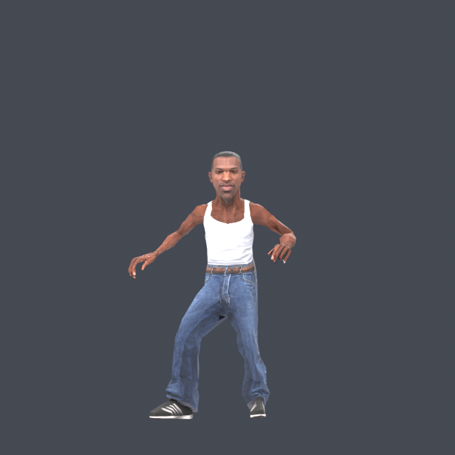

# Doritos Crash Course — Native PC

A Windows x64 port of **Doritos Crash Course**, with native keyboard, mouse and controller input, PC video settings, and a character importer. **CJ is the bundled default character.**

[Build guide](docs/BUILDING.md) · [Character importer](docs/CHARACTERS.md) · [Credits](docs/CREDITS.md)

An [independent native engine rewrite](docs/NATIVE_ENGINE.md) is being developed alongside the working recompiled port. Its separate Direct3D 11 previews support CJ animation, course/environment rendering, basic movement, stationary conveyor motors, a skeletal square-hammer preview and a partial native trigger/checkpoint session. Converted static collision retains owning platform identity; selected conveyor textures scroll on a persistent unscaled effect clock. Obstacle interactions, actor-group activation, complete graphics effects, remaining movement actions, audio and game flow are still being rewritten. `Launch.cmd` continues to run the working port.



## What works

- All **15 courses** pass loading and brief live gameplay checks: USA, Europe and Japan. This does not establish full-course completion.
- Textured CJ uses the original character animation system. The importer converts GLB, glTF, FBX and OBJ models and supports manual fitting in Blender.
- Native D3D9 graphics and XAudio2 playback, local profiles, keyboard/mouse/controller controls, skippable logos and offline menus.
- In-game display, filtering, frame-cap, image and presentation settings with Apply/Keep/Revert.
- Map-loading fixes cover the active batch palettes on USA 3, USA 5 and Japan 1. Unavailable offline leaderboard sign-in no longer stops local play.

This is an **experimental source release**, version 0.1.0. Xbox Live services are unavailable. Save progression and every gameplay path have not been exhaustively verified. Performance depends on the machine; no particular frame rate is promised.

## Build and play

Bring your own supported, extracted Xbox 360 game files. This repository contains the port source, tools and separately attributed replacement assets. Original executables, packages, skeletons, animations, extracted shaders and translated game code are generated or supplied locally.

Requirements: Windows x64, Python 3.11+ with Tkinter, Git, CMake 3.24+, Visual Studio 2022 Build Tools with ClangCL and the Windows SDK, and the DirectX June 2010 runtime (`d3dx9_43.dll`). Blender is needed only for importing custom models; the supplied CJ pack is already converted.

Place the original encrypted `default.xex` and `data.pak` in `game/`, then follow the [build guide](docs/BUILDING.md), including the first-build shader capture step:

```powershell
powershell -ExecutionPolicy Bypass -File tools/build.ps1
```

After completing that step, run **`Launch.cmd`**. CJ is selected on a fresh installation. No Blender installation is required to play with CJ.

## Import a character

Open **`Character Importer.cmd`**. Choose a model, leave **Auto fit** enabled for a first attempt, and choose **Import character**. The selected character appears on the next `Launch.cmd` run. **Restore CJ** returns to the default.

Models should be upright humanoids in a rest pose, with one to four mesh/material groups. Each material can use one directly connected base-color image or a solid base color. Complex shaders need baking. Automatic fitting and surface weight transfer are starting points; unusual proportions may need manual work in the saved Blender scene.

```powershell
py -3 tools/character_importer.py import-model "C:\Models\hero.glb" --name "My character" --activate
py -3 tools/character_importer.py select cj
.\Launch.cmd --character cj
```

See the [complete importer guide](docs/CHARACTERS.md) for fitting, installation, limits and command-line use.

## Controls and settings

Use WASD or arrow keys to move, Space/Enter to jump or confirm, Escape to pause or go back, R to restart the area and Backspace to restart the level. In menus, left-click selects, right-click goes back and the wheel navigates. Controllers retain the original controls.

Open **Help & Options → Video Settings** for display mode, monitor, render/output resolution, aspect ratio, VSync, foreground/background caps, filtering, anisotropy, mip bias, latency, FPS display, FXAA, sharpening and image adjustments. Choose Apply, then Keep Changes within 15 seconds. Native video settings are stored separately in `saves/video-settings.ini`.

## How it is built

[XenonRecomp](https://github.com/hedge-dev/XenonRecomp) translates PowerPC instructions to C++ ahead of time. Native Windows code supplies operating-system, input, audio and graphics services. There is no CPU interpreter, JIT, Xenia runtime or ReXGlue runtime in this build. The loader verifies and decodes the supported original encrypted executable in memory without modifying it.

The generator is pinned and patched locally. The generator corrections and context template derive from [The Darkness Recomp](https://github.com/portingpete/The-Darkness-Recomp/tree/4f711819bbc6ea12633a3b031454b86b5c0d929e). The native runtime, renderer, tooling and contracts live in `runtime/`, `renderer/`, `tools/` and `tests/`. Proprietary build products stay in ignored `build_native/` storage.

## Verification

```powershell
ctest --test-dir build_native/native -C Release --output-on-failure
py -3 -m unittest discover -s tests -p test_character_importer.py
py -3 tools/audit_public_source.py --pak game/data.pak
```

The October 19 map sweep used copied saves and test-only unlocks in isolated runs. It covered loading plus brief gameplay on all 15 maps and repeated main-menu returns. Importer verification covers conversion, pack validation, local selection, default CJ and imported characters in USA 1. These checks preserve the user's originals, normal progression and normal character overlay. Private test logs, captures and original data are excluded from the repository.

The independent rewrite has a separate 15-contract CPU/source suite. After building and converting its assets, additional bounded checks are available:

```powershell
& 'build_native/engine/engine/Release/NativePlatformTests.exe' '<absolute-assets-directory>'
& 'build_native/engine/engine/Release/NativeConveyorTests.exe' '<absolute-assets-directory>'
& 'build_native/engine/engine/Release/NativeActorTests.exe' '<absolute-assets-directory>'
& 'build_native/engine/engine/Release/DoritosNativeEngine.exe' --hidden --verify-conveyors '<absolute-fresh-evidence-directory>' --assets '<absolute-assets-directory>'
& 'build_native/engine/engine/Release/DoritosNativeEngine.exe' --hidden --verify-actors '<another-absolute-fresh-directory>' --assets '<absolute-assets-directory>'
```

Replace the quoted paths; each evidence directory must be new. The conveyor command probes four belts in the first USA section and records fixed-pose UV pairs. The actor command captures an authored square hammer through resume, pause, reset and a held final pose; it does not test player impacts or actor-group activation. Synthetic tests cover one-shot air carry, strict jump queues and an ordinary landing delay. An original-runtime conveyor comparison has not been collected. Starting-platform checks and the working port's map sweep do not establish full native gameplay parity. See the [native engine scope and commands](docs/NATIVE_ENGINE.md) for remaining work.

## License and credits

Port source and generator patches: **GPL-3.0**, see [COPYING](COPYING). CJ model: **CC BY 4.0**, by derry@pennywise (`abhishekambily`), fitted and converted for this project; see [model attribution](assets/characters/cj/LICENSE.txt). Kenney input prompts: **CC0**. Native Lua: **MIT**, see [dependency details](engine/THIRD_PARTY.md). The preview depicts the converted CJ model.

Original game and character names belong to their respective owners. This is an independent fan project. Developed with assistance from OpenAI Codex; live game testing used Luna Max agents. See [full credits and provenance](docs/CREDITS.md).
